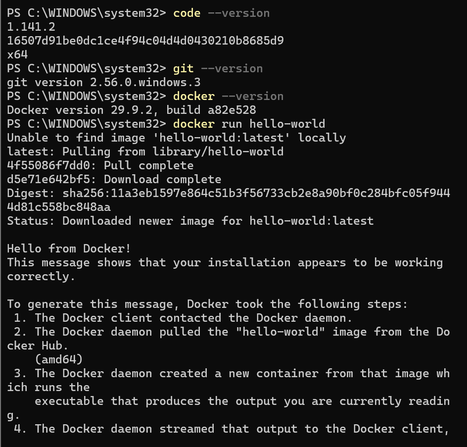
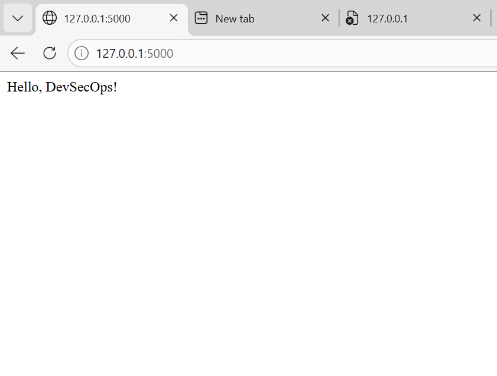
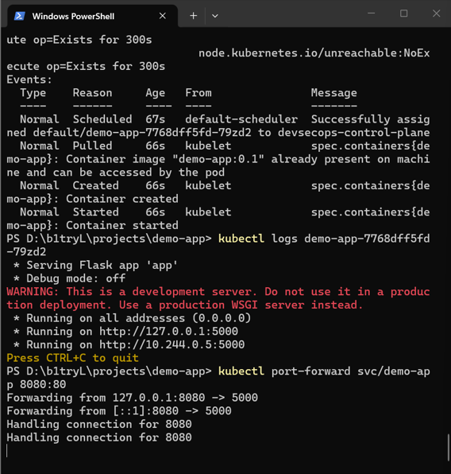
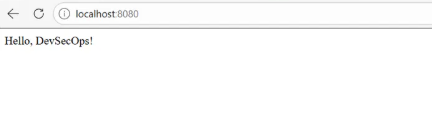

# PHASE 0 - Foundations
This is the first phase of my DevSecOps journey. My first role was a "DevOps Platform Engineer" that was later renamed to "Technical Support Engineer" at Trend Micro.  I have not touched Github for a long time and I wanted to rebuild the basics properly. 

I don't have any knowledge in DevSecOps as well because even though the role was DevOps Platform Engineer, the task assigned to us is morely Tech Supp, so this is really a FRESH START.

As this is a fresh start, I want to properly build the foundations needed for the career path that I want.

Technically, this phase is all about getting one small app from my laptop to a running Kubernetes pod, with a CI pipeline in the middle.

The app itself is tiny on purpose as I just want to feel familiar with it and so I can have a path it travels where the security checks will go later.

Code is in a separate repo: https://github.com/Reirinn/demo-app

## WHAT I BUILT
```
laptop --> Github --> Github Actions (test + build) --> Docker Images --> Kubernetes (kind)
```
- A small flask app that returns one line of text
- One pytest for it
- A Dockerfile to package it as an image
- A Github Actions Workflow that runs the test and builds the image on every pull request
- A local Kubernetes cluster (kind) running 2 copies of the app behind a Service

## TOOLS
1. Github -> version control, branches, pull requests
2. VSCode -> writing the files
3. Docker Desktop -> building the image and containers
4. Github Actions -> Running tests and the image build automatically
5. kind -> a kubernetes cluster that runs inside Docker on my laptop
6. kubectl -> the one talking to the cluster 

Installed with winget on Windows. WSL2 was needed for Docker Desktop.

## WHAT I DID
**1. Set-up Github** 
Turned 2FA on.  Set my name and email in Git. Created this journal repo and cloned it. Practiced the basic loop until I could type it without looking on a cheatsheet haha : 'git add', 'git commit', 'git push'.

**2. Branches and pull requests.** From here on I never changed `main` directly. Every change got its own branch and a pull request, even though I'm the only one working on it.

```
git switch -c my-branch
git add file
git commit -m "message"
git push -u origin my-branch
```

**3. The demo app.** Three files: `app.py` (Flask), `test_app.py` (one test that checks the home page returns 200), and `requirements.txt`.

**4. Docker.** Wrote a Dockerfile, built the image and ran it:

```
docker build -t demo-app:0.1 .
docker run --rm -p 5000:5000 demo-app:0.1
```

The page loaded at localhost:5000. I also added a `.dockerignore` so files like `.git` and `.env` don't end up inside the image. Checked `whoami` inside the container and it was root, which I want to fix in a later phase.

**5. CI with GitHub Actions.** The workflow lives in `.github/workflows/ci.yml`. It runs on pull requests and on pushes to main. It installs the requirements, runs pytest, and builds the Docker image. I set the token permissions to read-only. To see what a failure looks like, I broke the test on purpose and checked the log.

**6. Kubernetes.** Created a cluster with kind, loaded the image into it, and applied a manifest with a Deployment (2 replicas) and a Service.

```
kind create cluster --name devsecops
kind load docker-image demo-app:0.1 --name devsecops
kubectl apply -f k8s/app.yml
kubectl port-forward svc/demo-app 8080:80
```

Then I deleted a pod to see what happens. A new one showed up within seconds. I also scaled up to 4 replicas and back to 2, and tried an image tag that doesn't exist to see a failed rollout (`ImagePullBackOff`).

## Screenshots



Tools installed. After installing everything with winget, I checked each version from PowerShell. `docker run hello-world` pulled the image and printed its success message, so Docker was working.



App running in a Docker container. The first time my image ran as a container. This is the page served on port 5000 from `docker run`.



Pod running in Kubernetes. The events at the bottom of `kubectl describe pod` show the pod being scheduled, started, and using the `demo-app:0.1` image I loaded into the cluster. `kubectl logs` shows Flask starting up, and it also prints a warning that this is a development server and shouldn't be used in production. That's on my list to fix later. The last command is `kubectl port-forward`, and "Handling connection for 8080" shows it was receiving my requests.



App served from the cluster. Same page as before, but this time it comes from a pod in the kind cluster through the Service, on localhost:8080.

## THINGS THAT WENT WRONG

This part taught me the most.

- **Typo in the Dockerfile.** I wrote `--no-cachedir` instead of `--no-cache-dir`. The build log told me exactly which option pip didn't recognise.
- **Wrong package in requirements.txt.** pip said it couldn't find a package called `python`. I had typed the wrong name in the file.
- **CI failed on the docker build step.** I had left out the `.` at the end, so Docker had no build path. The log showed pytest passing and only this step failing, which made it easy to find.
- **I merged a pull request before the check finished.** It failed afterwards. New rule for myself: no green check, no merge.
- **Committed straight to main by accident.** The same fix had already gone in through a pull request, so my local `main` and GitHub's `main` had diverged and Git got stuck in the middle of a merge. I had to run `git merge --abort` and reset my local main to match GitHub. After that I set `git config --global pull.ff only` so it can't happen quietly again.
- **Pushed before committing.** The branch went up empty. The order is edit, add, commit, push.
- **Ran Git commands from the wrong folder.** A few "pathspec did not match" errors came from standing inside a subfolder.
- **Network error on push.** "Could not resolve host" was a connection problem, not a Git problem. The commits were fine and I pushed later.
- **Misspelled my kind cluster name.** kind can't rename a cluster, so I deleted it and made it again.

## WHAT IS STILL WEAK

I know these are not good yet. They are the reason for the next phases.

- The container runs as root
- Dependencies are not pinned to specific versions
- The GitHub Actions steps are referenced by tag, not by commit SHA
- Nothing stops me from merging a pull request with a failing check
- No secret scanning, no image scanning
- The pods have no resource limits or network restrictions
- Flask's built-in dev server is not meant for production
